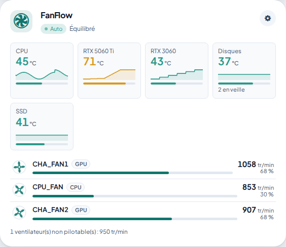
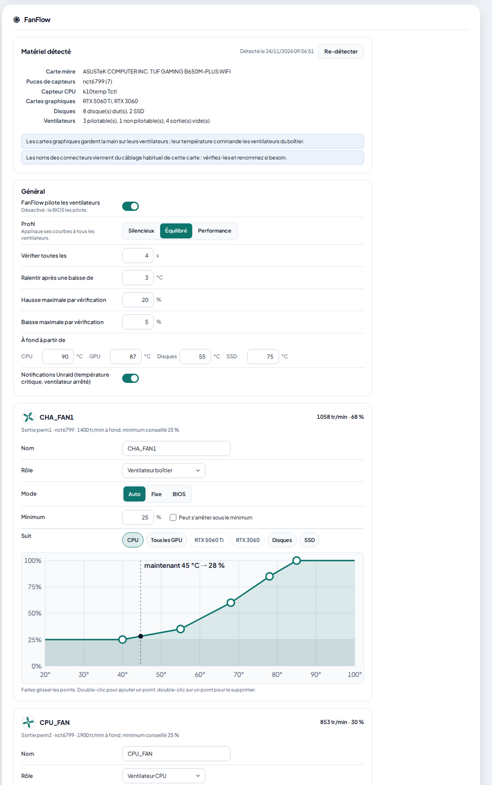

# FanFlow

Plugin Unraid qui pilote les ventilateurs selon la température du CPU, des cartes graphiques et des disques, avec une carte sur le tableau de bord. Il détecte le matériel tout seul et fonctionne dès l'installation, sans réglage.

*Unraid plugin that drives the fans from the CPU, graphics card and disk temperatures, with a Dashboard tile. It finds the hardware by itself and works as soon as it is installed. English below.*



## Ce qu'il fait

- **Détection automatique**, à l'installation puis vérifiée à chaque démarrage :
  - charge le pilote de la puce des capteurs s'il manque (`nct6775`, `it87`…) ;
  - trouve le capteur du CPU (AMD `k10temp`, Intel `coretemp`), les cartes graphiques (Nvidia par `nvidia-smi`, AMD, Intel) et les disques ;
  - trouve quel connecteur commande quel ventilateur : chaque sortie monte à 100 % quelques secondes et on regarde quel ventilateur accélère ;
  - mesure la plage de vitesse de chaque ventilateur, en descendant jusqu'à 25 % au plus bas ; le test s'arrête si le CPU dépasse 70 °C.
- **Pilotage** toutes les 4 s. Chaque ventilateur suit une ou plusieurs courbes et prend la vitesse la plus haute :
  - par défaut, le ventilateur CPU suit le CPU ;
  - les ventilateurs du boîtier suivent le CPU, les cartes graphiques, les disques durs et les SSD.

  Ils ne ralentissent qu'après 3 °C de baisse et changent de vitesse en douceur.
- **Les cartes graphiques gardent leurs propres ventilateurs** : FanFlow n'y touche jamais, il se sert seulement de leur température.
- **Les disques en veille ne sont jamais réveillés** : la température vient des fichiers qu'Unraid tient à jour.
- **Sécurités** :
  - capteur CPU muet, température critique ou arrêt imprévu du service : tous les ventilateurs passent à 100 % ;
  - un ventilateur commandé qui affiche 0 tr/min déclenche une alerte Unraid ;
  - si un autre programme pilote les ventilateurs, FanFlow n'écrit plus rien ;
  - à l'arrêt ou à la désinstallation de FanFlow, le BIOS reprend la main.
- **Page Réglages** (Settings > User Utilities > FanFlow) :
  - profils Silencieux, Équilibré et Performance ;
  - courbes dont on déplace les points à la souris ;
  - par ventilateur : mode Auto, vitesse fixe ou BIOS, minimum, nom et rôle ;
  - seuils de passage à 100 % et notifications.
- Français ou anglais, selon la langue du webGUI. La carte et la page suivent le thème Unraid (clair ou sombre) et Glacier-Theme.



## Installation

Unraid 7.0 ou plus récent. Dans **Plugins > Install Plugin**, collez :

```
https://raw.githubusercontent.com/R0m1k3/FanFlow/main/fanflow.plg
```

Au premier démarrage, la détection prend 2 à 4 minutes, pendant lesquelles chaque ventilateur accélère puis ralentit. Pour les cartes graphiques Nvidia, la température vient de `nvidia-smi` (plugin Nvidia Driver).

Si aucune sortie de ventilateur n'est pilotable, la page Réglages le dit. Sur certaines cartes mères, la puce est réservée par le firmware : l'option de démarrage `acpi_enforce_resources=lax` la libère. FanFlow la propose mais ne la pose jamais lui-même.

En ligne de commande : `/etc/rc.d/rc.fanflow start|stop|restart|status|detect`.

## English

FanFlow detects the sensor chip, the CPU, graphics card and disk temperatures, and which output drives which fan (each output is raised to 100 % for a few seconds). It then drives the fans from curves, with sensible defaults.

- Graphics cards keep their own fans. Sleeping disks are never woken up.
- Every fan goes to full speed if the CPU sensor stops answering, past a critical temperature, or if the service stops unexpectedly.
- The BIOS gets the fans back when FanFlow is stopped or removed.

Install from **Plugins > Install Plugin** with the URL above. The settings are in Settings > User Utilities > FanFlow.

## Développement

```
php test/unit/run.php                       # calculs + service sur 3 machines simulées
php test/fixture.php                        # réponses de status.php pour le rendu
node test/render.mjs /root/dev/unraid-webgui /root/dev/Glacier-Theme   # captures + interactions
python3 plugin/build.py                     # produit fanflow.plg
```

- `test/sim/` simule une machine complète : `/sys/class/hwmon` dont les ventilateurs suivent leurs sorties, DMI, `disks.ini` et un faux `nvidia-smi`. Le service tourne dessus avec `FANFLOW_ROOT=<dossier>`.
- `plugin/src/` contient les fichiers du plugin :
  - `scripts/fanflowd` : le service ;
  - `include/lib/` : la détection, les capteurs et les courbes ;
  - `include/*.php` : l'API des pages ;
  - `assets/` : l'interface ;
  - `include/boards.json` : les noms des connecteurs des cartes mères connues.
